# 🚗 360° 智能行车辅助系统 (Smart Driving Assistance System)

<p align="left">
  
  
  
  
  
</p>

基于 **Linux 高并发服务器 + Qt 客户端** 的智能行车辅助系统。通过车载摄像头采集车辆四周影像，实现**行车、倒车、360° 鸟瞰**等多种模式的实时监控，具备**车辆识别、红绿灯检测、行车记录、倍速回放与特征截图分片上传**功能，并通过 TCP/IP 网络将关键数据同步至云端服务器。

本项目采用 **C/S 架构**，服务器端拆分为「**前置接入层 + 后置业务层**」双层结构，通过 System V 共享内存、消息队列与信号量实现高效 IPC 通信，涵盖 **Linux 高并发网络编程、Qt 桌面端开发、OpenCV 机器视觉及 MySQL 连接池操作**。

---

## 📑 目录

- [📸 运行效果展示](#-运行效果展示)
- [✨ 功能特性](#-功能特性)
- [🏗️ 系统架构](#️-系统架构)
- [📂 目录结构](#-目录结构)
- [🛠️ 环境依赖](#️-环境依赖)
- [🚀 快速开始](#-快速开始)
- [📡 通信协议](#-通信协议)
- [💡 核心技术细节](#-核心技术细节)
- [⚙️ 配置说明](#️-配置说明)
- [📜 许可证](#-许可证)

---

## 📸 运行效果展示

### 1. 核心驾驶辅助模式

| 🛣️ 行车模式（红绿灯/车辆实时检测 + 自动录制） | 🔙 倒车模式（红/黄/绿三级安全辅助线 + 危险预警） |
| :---: | :---: |
| 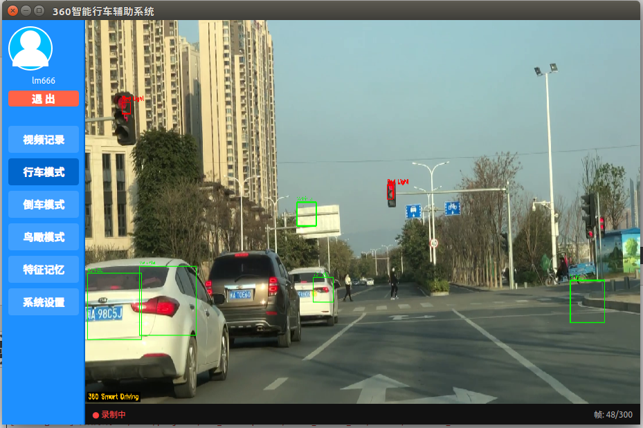<br/>*(OpenCV 实时识别红绿灯 `Red Light` 与前方车辆 `Vehicle`)* | 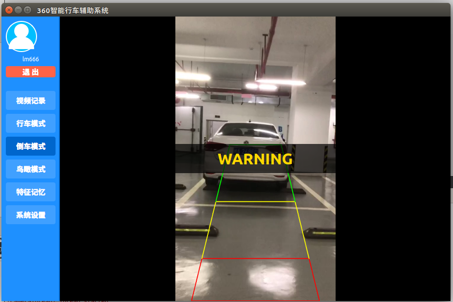<br/>*(倒车影像实时绘制安全/警告/危险区域辅助线与 `WARNING` 提示)* |

| 🦅 360° 鸟瞰全景模式（四路透视变换拼接） | 🔍 特征图片高清预览（绿灯与车辆检测标记） |
| :---: | :---: |
| 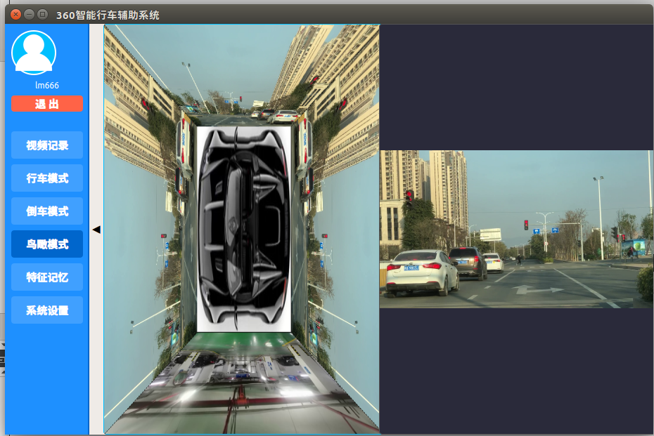<br/>*(左侧 360° 环视俯视拼接全景 + 右侧实时前方路况对照)* | 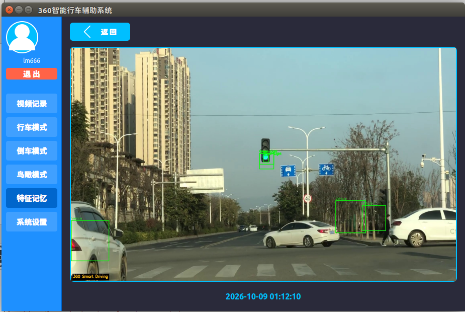<br/>*(查看已上传的特征截图大图，保留视觉检测框与时间戳)* |

### 2. 媒体中心与回放系统

| 🎬 行车视频记录列表（观看进度云端同步） | ▶️ 视频播放器（倍速播放 + 一键截图上传） |
| :---: | :---: |
| 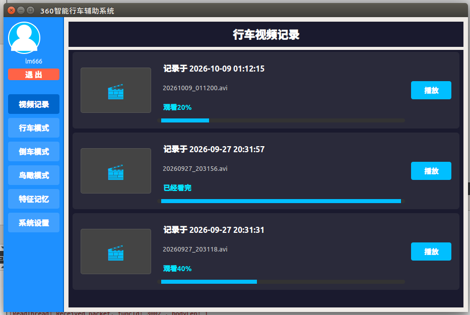<br/>*(分页展示本地录制视频，自动同步并显示观看百分比进度条)* | 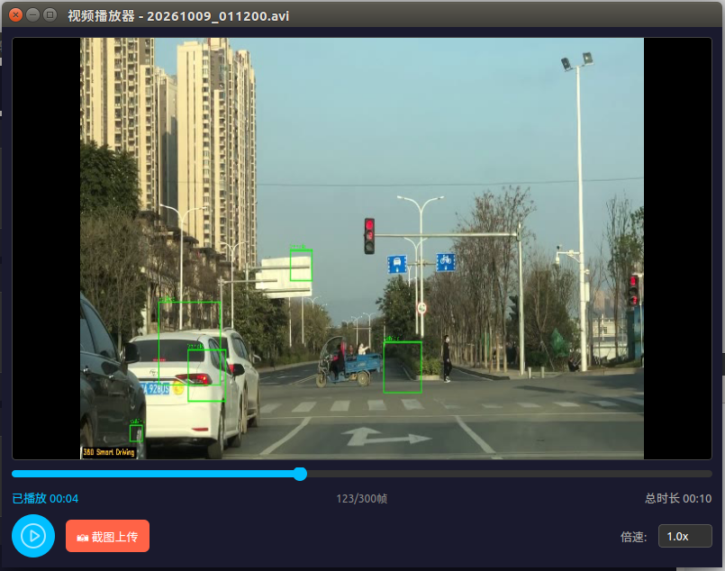<br/>*(支持进度拖拽、倍速切换、帧数显示及手动截帧上传云端)* |

| 🖼️ 特征记忆列表（云端同步特征截图记录） | ⚙️ 系统设置（网络配置与存储循环覆盖策略） |
| :---: | :---: |
| 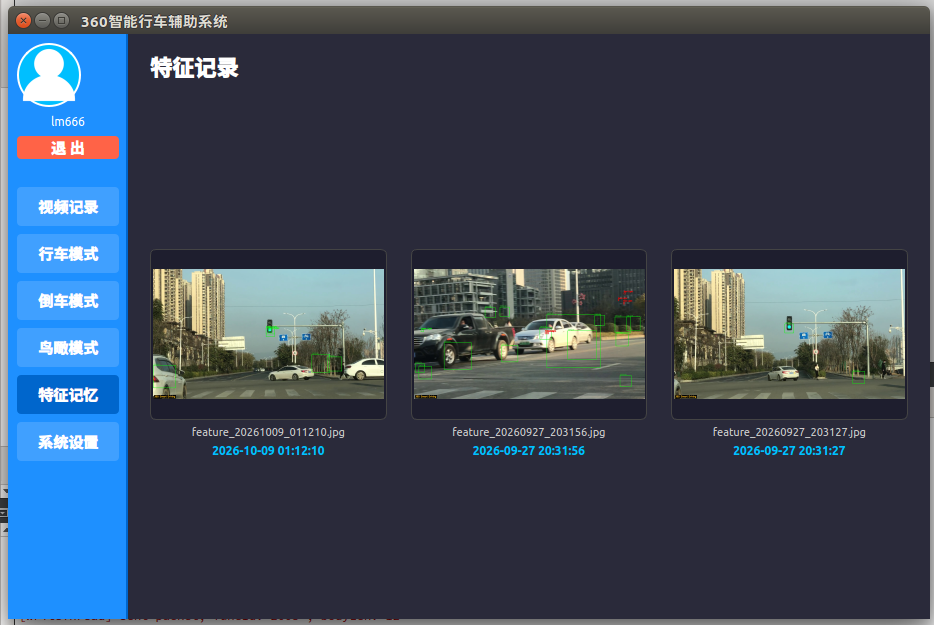<br/>*(分页展示已上传的特征截图缩略图、文件名与捕获时间)* | 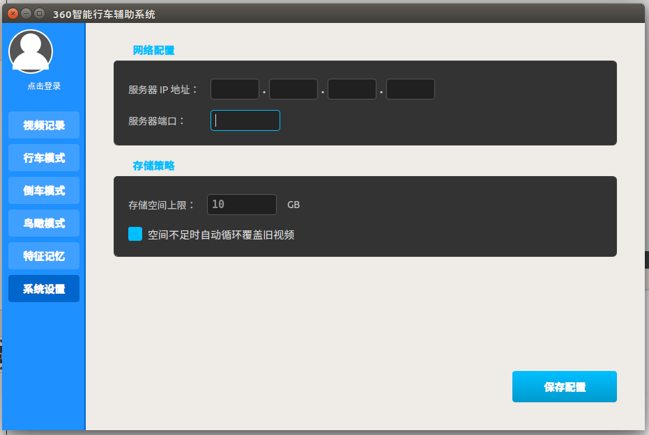<br/>*(配置服务器 IP/端口、本地存储上限及空间不足自动覆盖策略)* |

### 3. 账号安全与认证模块

| 🔐 用户登录界面 | 📝 新用户注册界面（对接短信验证码平台） |
| :---: | :---: |
| 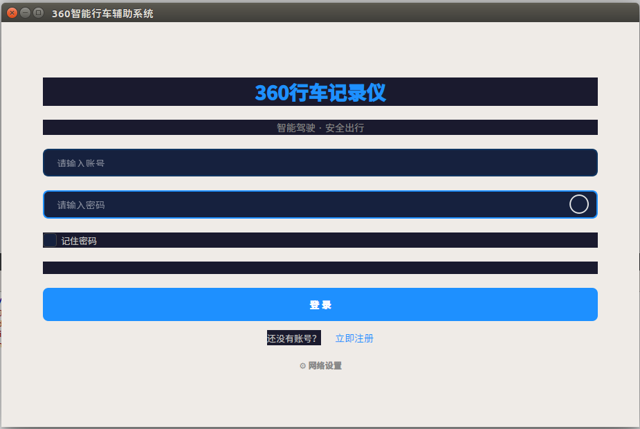<br/>*(支持密码 MD5 加密传输、记住密码及快捷网络设置)* | 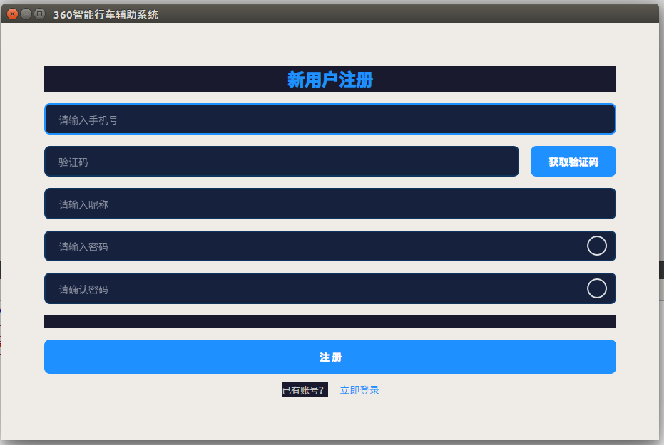<br/>*(对接互亿无线短信接口，支持手机验证码校验注册)* |

---

## ✨ 功能特性

### 🖥️ 客户端 (Qt 端)

| 模块 | 详细说明 |
| :--- | :--- |
| **🚀 开机动画** | 使用 OpenCV 读取并播放视频帧作为系统启动引导动画。 |
| **⚙️ 系统设置** | 配置服务器 IP / 端口、存储空间上限及循环覆盖策略，持久化保存至本地配置文件。 |
| **🔐 注册 / 登录** | 密码经客户端 **MD5 加密**后传输；注册模块对接**互亿无线短信平台**发送手机验证码。 |
| **🛣️ 行车模式** | 实时渲染摄像头画面，基于 **OpenCV 级联分类器**实现**红绿灯检测**与**车辆识别**；每 10 秒自动录制 300 帧视频（`.avi`）。 |
| **🔙 倒车模式** | 实时倒车影像显示，动态绘制**安全区（绿）/ 警告区（黄）/ 危险区（红）**三级辅助线与 `WARNING` 告警，同时后台保持视频录制。 |
| **🦅 鸟瞰模式** | 通过 OpenCV **透视变换（Perspective Transform）**与图像拼接技术，实时合成车身四周 360° 全景俯视图。 |
| **🎬 视频列表与回放** | 分页展示本地录制视频与观看进度百分比，内置播放器支持倍速播放、进度跳转，并在退出时自动向服务器同步观看时长。 |
| **☁️ 特征截图分片上传** | 支持行车每 15 秒自动截帧上传及播放器手动截图上传；图片拆分为 **1KB 切片**传输，支持**缺失切片断点重传**，实现本地与云端双备份。 |

### ☁️ 服务器端 (Linux 端)

| 模块 | 详细说明 |
| :--- | :--- |
| **🛡️ 前置接入服务器** | 面向对象 Socket 封装 + **Epoll IO 多路复用** + 线程池，负责海量客户端并发连接管理、心跳保活及实时请求日志打印。 |
| **⚙️ 后置业务服务器** | **32 工作线程池** + **自研 MySQL 连接池**，通过工厂模式（`OperationFactory`）分发用户、视频、图片等核心业务。 |
| **🔄 高速进程间通信** | 采用 **System V 共享内存**（4MB，划分为 1024 个 4KB 数据块）+ **信号量** + **双向消息队列（F2B / B2F）** 解耦网络层与业务层。 |
| **🔗 接入与会话管理** | 维护客户端 Session 映射、超时未登录自动断开、心跳包保活检测。 |

---

## 🏗️ 系统架构

系统采用 **前置服务器 + 后置服务器** 双层解耦架构，通过共享内存与双消息队列进行进程间通信（IPC），实现高并发处理能力。

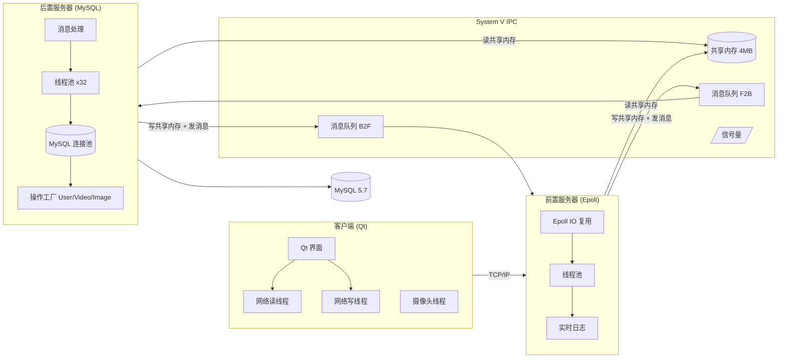

**一次完整请求的数据流：**

1. **客户端请求**：客户端封装二进制协议包发送请求 → 前置服务器（Epoll 监听触发）
2. **前置转发**：前置服务器 → 线程池处理 → 将数据写入共享内存块 → 发送消息队列（`F2B`）→ 后置服务器
3. **后置处理**：后置服务器 → 监听消息队列 → 线程池处理 → 读取共享内存并释放块 → 通过 MySQL 连接池执行数据库操作 → 将响应写入新共享内存块 → 发送消息队列（`B2F`）→ 前置服务器
4. **响应返回**：前置服务器 → 接收返回消息 → 读取共享内存响应数据 → 通过 Socket 发送回客户端

---

## 📂 目录结构

```text
.
├── Server_Front_new/                # 前置服务器（接入层）
│   ├── main.cpp                     # 入口：Epoll + 线程池 + IPC 初始化
│   ├── epollserver.cpp/.h           # Epoll IO 复用服务器封装
│   ├── threadpool.cpp/.h            # 线程池实现
│   ├── ipc.cpp/.h                   # 共享内存 + 信号量 + 消息队列封装
│   ├── protocol.h                   # 通信协议（与后端、客户端共用）
│   └── Makefile
├── Server_Back_new/                 # 后置服务器（业务层）
│   ├── main.cpp                     # 入口：32 个工作线程 + 业务分发
│   ├── DBConnection.cpp/.h          # MySQL 连接单例封装
│   ├── dbpool.cpp/.h                # MySQL 数据库连接池
│   ├── OperationFactory.cpp/.h      # 业务操作工厂
│   ├── UserOperation.cpp/.h         # 登录 / 注册 / 验证码业务
│   ├── VideoOperation.cpp/.h        # 视频信息与播放进度记录业务
│   ├── ImageOperation.cpp/.h        # 图片切片接收 / 拼合 / 列表业务
│   ├── SmsClient.cpp/.h             # 短信平台 HTTP 客户端（互亿无线）
│   ├── ipc.cpp/.h                   # IPC 封装
│   ├── protocol.h                   # 通信协议
│   ├── test.md                      # 终端模拟测试脚本（纯 C++ 测试客户端源码）
│   └── Makefile
└── third_360Car_new/                # 客户端（Qt）
    ├── third_360Car.pro             # qmake 工程文件
    ├── main.cpp / mainmanager.*     # 主界面（QStackedWidget 页面管理）
    ├── loginwidget.* / registerwidget.* # 登录 / 注册界面
    ├── startupwidget.*              # 开机动画模块
    ├── settingspage.* / syssetting.*    # 系统设置与配置持久化
    ├── drivingmodepage.*            # 行车模式（车辆 / 红绿灯检测 + 自动录制）
    ├── reversemodepage.*            # 倒车模式（三级辅助线绘制与告警）
    ├── birdviewpage.*               # 鸟瞰模式（透视变换全景拼接）
    ├── videorecordpage.* / videoplayer.* / featurememorypage.* # 视频列表 / 播放 / 特征图片列表
    ├── socketconnect.* / readthread.* / writethread.*          # 网络连接与读写线程
    ├── camerathread.*               # 摄像头采集线程
    ├── protocol.h                   # 通信协议
    ├── haarcascade_car.xml          # OpenCV 车辆检测级联分类器模型
    ├── darkstyle.qss                # 深色主题样式表
    ├── resources.qrc                # Qt 资源文件
    └── assets/ images/              # 演示视频与界面图标素材
```

---

## 🛠️ 环境依赖

| 组件 | 版本要求 | 说明 |
| :--- | :--- | :--- |
| **操作系统** | Ubuntu 16.04+ / Linux | 客户端与服务端部署环境（服务端支持 VS Linux 远程开发） |
| **Qt 框架** | Qt 5.9.8 | 含 `qmake` 与 Qt Creator |
| **OpenCV** | OpenCV 3.4.2 | 安装于 `/usr/local` |
| **数据库** | MySQL 5.7 | 存储用户、视频记录与特征图片元数据 |
| **MySQL 驱动** | `libmysqlcppconn-dev` | MySQL Connector/C++ |
| **编译器** | `g++` (支持 C++11) | 需链接 `-lpthread`、`-lmysqlcppconn` |
| **短信接口** | 互亿无线 (`api.ihuyi.com`) | 用于发送注册短信验证码 |

---

## 🚀 快速开始

### 1. 数据库准备

启动 MySQL 服务，创建数据库与相应的数据表：

```sql
CREATE DATABASE IF NOT EXISTS OMO250701 DEFAULT CHARACTER SET utf8mb4;
```

需创建以下核心表（字段以 `Server_Back_new` 各 `Operation` 源码中的 SQL 为准）：
- `user`：用户表（`id`、`username` 手机号、`nickname` 昵称、`password_hash` MD5 密码）
- `video`：视频记录表（`user_id`、`video_name`、`client_path`、`cover_path`、`file_size`、`status` 等）
- `video_record`：播放进度记录表（`video_id`、`user_id`、`total_duration`、`watch_duration`）
- `feature_image`：特征图片表（`user_id`、`file_name`、`file_path`、`file_size`、`create_time`）

### 2. 编译并启动后置服务器

在编译前，请先确认 `Server_Back_new/DBConnection.h` 中的数据库密码及 `Server_Back_new/SmsClient.cpp` 中的短信 API 秘钥已正确配置：

```bash
cd Server_Back_new
make clean && make
./server_back
```

### 3. 编译并启动前置服务器

```bash
cd Server_Front_new
make clean && make
./server_front 8080
```
> 前置服务器默认监听 `8080` 端口，可通过命令行参数自定义端口。

### 4. 编译并运行客户端

在安装了 Qt 5.9.8 与 OpenCV 3.4.2 的 Ubuntu 环境下：

```bash
cd third_360Car_new
qmake third_360Car.pro
make
./third_360Car
```

或者使用 **Qt Creator** 直接打开 `third_360Car.pro` 构建并运行。首次运行时点击「**系统设置 / 网络设置**」配置服务器 IP 与端口，保存后即可注册、登录并体验全部功能。

### 5. 终端模拟测试（可选）

`Server_Back_new/test.md` 提供了一份无需 GUI 的纯 C++ 终端测试客户端源码（覆盖登录、注册、视频列表分页、图片切片上传全流程）：

```bash
cp Server_Back_new/test.md /tmp/test_client.cpp
g++ -std=c++11 /tmp/test_client.cpp -o /tmp/test_client -lpthread
/tmp/test_client
```

---

## 📡 通信协议

协议定义在 `protocol.h`（前置、后置、客户端三端共用），采用 **定长包头 + 变长包体** 的自定义二进制协议，所有结构体均使用 `#pragma pack(1)` 紧凑字节对齐，有效解决 TCP 粘包与半包问题：

```c
#pragma pack(1)
typedef struct head {
    uint16_t type;    // 业务功能号 (FID)
    uint32_t length;  // 包体长度
    uint32_t crc;     // 包体校验码
} HEAD;
#pragma pack()
```

### 功能号一览

| 功能号 | 宏定义 | 业务说明 |
| -----: | :--- | :--- |
| `1000` | `FID_HEARTBEAT` | 心跳包（维持 TCP 长连接） |
| `1001` | `FID_LOGIN` | 用户登录认证 |
| `1002` | `FID_GET_SMS` | 请求发送手机短信验证码 |
| `1003` | `FID_REGISTER` | 新用户注册 |
| `2001` | `FID_IMG_UPLOAD` | 特征图片上传（元数据包） |
| `2002` | `FID_IMG_UPLOAD_SLICE` | 特征图片切片上传（每片 1KB） |
| `2003` | `FID_GET_IMG_LIST` | 分页获取特征图片列表 |
| `2004` | `FID_RETRANSMISSION_IMG` | 图片切片完整性校验与缺失重传响应 |
| `3001` | `FID_GET_VIDEO_LIST` | 分页获取行车视频列表 |
| `3002` | `FID_RECORD_UPLOAD` | 上传视频播放进度记录 |
| `3003` | `FID_INFO_UPLOAD` | 上传新录制完成的视频元数据 |

### 状态码定义

| 状态码 | 宏定义 | 说明 |
| -----: | :--- | :--- |
| `0` | `SUCCESS` | 操作成功 |
| `1` | `ERR_USER_EXIST` | 手机号/用户已存在 |
| `2` | `ERR_NAME_OR_PWD_ERR` | 账号或密码错误 |
| `3` | `ERR_CODE_ERR` | 短信验证码错误或已失效 |
| `4` | `ERR_SMS_FAIL` | 短信验证码发送失败 |
| `5` | `ERR_UPLOAD` | 数据上传或入库失败 |
| `6` | `ERR_SLICE_MISSING` | 图片切片存在缺失（触发客户端定点重传） |

---

## 💡 核心技术细节

### 1. 图片 1KB 切片上传与断点重传机制
针对车载网络不稳定、高清截图直接传输易丢包的问题，系统设计了可靠的分片上传机制：
1. **发送元数据**：客户端首先发送 `FID_IMG_UPLOAD` 包，告知文件名、切片总数 `totalSlices` 及唯一 `uploadId`。
2. **分片传输**：客户端独立线程将图片按 **1KB** 切分为 $N$ 片，逐片发送 `FID_IMG_UPLOAD_SLICE`（携带序号 `sliceIndex` 与末片标志 `isLastSlice`）。
3. **聚合与完整性校验**：后置服务器按 `uploadId` 缓存切片至内存字典，收到末片标志后检查 `[0, totalSlices - 1]` 序号是否齐全。
4. **定点重传**：若发现缺失切片，服务器通过 `FID_RETRANSMISSION_IMG` 返回缺失序号数组（`ERR_SLICE_MISSING`），客户端仅重传缺失切片，直至校验通过后合并落盘并写入 MySQL。

### 2. 客户端多线程异步架构
为保障视频实时渲染与 OpenCV 视觉检测不阻塞 UI 主线程，客户端严格采用多线程解耦设计：
- **摄像头采集线程（单例）**：独立循环采集视频帧并通过信号槽分发给各模式页面。
- **网络读 / 写线程（单例）**：异步处理二进制协议包的封包发送与粘包解析。
- **文件拆分上传线程**：在后台完成图片切片读取与重传调度。
- **心跳保活线程**：定时发送 `FID_HEARTBEAT` 维持长连接。

### 3. 高并发 System V IPC 共享内存池
前后置服务器位于同一主机，摒弃传统 Socket 转发开销，采用内存级 IPC 通信：
- **共享内存分块管理**：预分配 **4MB** 共享内存，划分为 **1024 个 4KB 数据块**，块头记录占用标志与数据长度。
- **轻量级消息队列**：`F2B` 与 `B2F` 双消息队列仅传递 `clientFd`、`funcId` 和**共享内存块索引（`shmBlockIndex`）**，避免大块数据拷贝。
- **信号量同步**：通过 System V 信号量实现多进程、多线程对共享内存块分配与释放的互斥访问。

---

## ⚙️ 配置说明

在编译部署前，请根据实际环境修改以下配置项：

| 配置项 | 所在文件 | 说明 |
| :--- | :--- | :--- |
| **MySQL 连接参数** | `Server_Back_new/DBConnection.h` | 配置数据库 IP、端口、用户名、密码及库名 `OMO250701` |
| **短信平台 API 秘钥** | `Server_Back_new/SmsClient.cpp` | 将 `<YOUR_SMS_API_ID>` 与 `<YOUR_SMS_API_KEY>` 替换为互亿无线真实凭据 |
| **前置服务器端口** | 命令行启动参数 | 例如 `./server_front 8080` |
| **客户端服务器寻址** | 客户端「系统设置」页面 | 界面修改后自动持久化保存在客户端本地配置文件中 |
| **IPC 键值** | `Server_Front_new/ipc.h` | 共享内存、消息队列与信号量的 System V Key 定义 |

---

## 📜 许可证

本项目为技术实战与课程学习项目，源代码仅供学习与技术交流使用。
